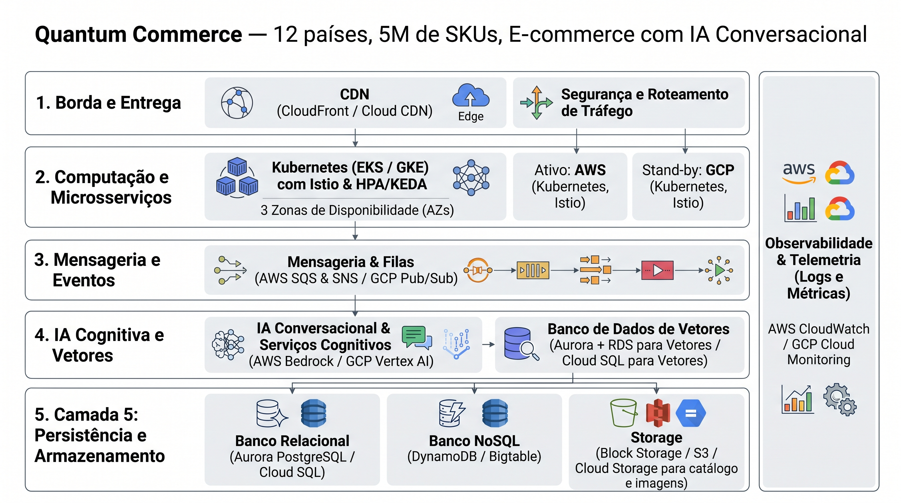

# Entrega Aula <01> — Grupo <01>

**Disciplina:** Cloud & Cognitive Environments — FIAP MBA AI Engineering & Multi-Agents
**Turma:** <6AIER>
**Data de entrega:** <xx/11/2026>

## Grupo

| # | Nome completo | GitHub | E-mail FIAP |
|---|---------------|--------|-------------|
| 1 | David, Vinicius, Jefferson, Laisa | [https://github.com/Davidjordao2019/qc-grupo-01-aula01](https://github.com/Davidjordao2019/qc-grupo-01-aula01/blob/main/entrega-grupo-aula01.md)  | rm379349@fiap.com.br |
| 2 | David, Vinicius, Jefferson, Laisa| | |
| 3 | David, Vinicius, Jefferson, Laisa| | |
| 4 | David, Vinicius, Jefferson, Laisa| | |
| 5 | David, Vinicius, Jefferson, Laisa| | |

## Distribuição do trabalho

| Membro | Nível assumido | Item específico |
|--------|----------------|-----------------|
| David, Vinicius, Jefferson, Laisa | 🟢 N1 | Exercícios 1.1, 1.2, 1.3 |
| David, Vinicius, Jefferson, Laisa | 🟡 N2 | Exercício 2.1 — Arquitetura QC |
| David, Vinicius, Jefferson, Laisa | 🟡 N2 | Exercício 2.2 — Comparativo |
| David, Vinicius, Jefferson, Laisa | 🔴 N3 (bônus) | Exercício 3.1 — IaC avançado |
| David, Vinicius, Jefferson, Laisa | 🟢 N1 (apoio) | Revisão das respostas N1 |

> Regra: cada membro deve ter pelo menos uma contribuição. O **rodízio entre aulas** (quem fez N1 antes faz N2 depois) é incentivado e vale o ponto do Critério 4 (ver [rubrica.md](rubrica.md)).

---

## 🟢 Nível 1 — Respostas

Para cada serviço, identifique se é IaaS, PaaS, SaaS ou FaaS. Justifique em uma frase.

| Serviço | Modelo (IaaS/PaaS/SaaS/FaaS) | Justificativa |
|---------|------------------------------|---------------|
| Gmail | SaaS | Usuário só utiliza o Serviços |
| Azure Virtual Machines | IaaS | Cliente gerencia SO, Middleware, Runtime, Data, Applications |
| Azure App Service (hospedar uma API) | PaaS | Cliente gerencia Data, Applications |
| AWS Lambda | FaaS | Cliente gerencia funções |
| Azure SQL Database | PaaS | Cliente gerencia SO, Middleware, Runtime, Data, Applications |
| Salesforce CRM | SaaS | Usuário só utiliza o Serviços |
| Google Kubernetes Engine (GKE) | PaaS/IaaS | Cliente gerencia pods, Data, Applications |
| Azure Blob Storage | PaaS | Cliente gerencia Data, Applications |
| Azure OpenAI Service | SaaS | Usuário só utiliza o Serviços  |

---

## 🟡 Nível 2 — Respostas + Implementação

### Exercício 2.1 — Arquitetura de alto nível: Quantum Commerce

**Contexto:** A Quantum Commerce é um gigante do e-commerce com 12 países, 5M de SKUs, e quer transformar a experiência de compra com IA conversacional.

**Sua tarefa (em grupo):** Proponha uma arquitetura de alto nível em cloud para a QC. Identifique:

1. **Camadas da arquitetura** — quantas e o que cada uma faz (ex: frontend, API, dados, AI/ML, observabilidade)

# Resposta 2.1
# Camadas da Arquitetura

---

## Camada 1 — Borda, Entrega e Frontend (CDN)
* **Serviços:** CloudFront (AWS) / Cloud CDN (GCP)
* **Responsabilidade:** Distribui conteúdo estático (imagens de catálogo, assets da interface web/mobile) e acelera o roteamento global para utilizadores nos 12 países com baixa latência, protegendo a infraestrutura de origem contra picos de tráfego.

---

## Camada 2 — Computação, APIs e Microsserviços (Backend)
* **Serviços:** Kubernetes com service mesh Istio, escalonamento automático via HPA/KEDA distribuído em 3 zonas de disponibilidade por célula (Ativo na AWS / Stand-by na GCP)
* **Responsabilidade:** Executa a lógica de negócio do e-commerce (carrinho, checkout, gestão de catálogo e orquestração da IA), garantindo isolamento de falhas por célula, comunicação segura entre microsserviços e elasticidade conforme o volume de pedidos ou mensagens na fila.

---

## Camada 3 — Mensageria e Integração Assíncrona
* **Serviços:** SQS e SNS (AWS) / Pub/Sub (GCP)
* **Responsabilidade:** Desacopla os microsserviços e absorve picos de requisições (ex.: processamento de pedidos, atualização dos 5M de SKUs e indexação de novos produtos para a IA), comunicando-se diretamente com o KEDA para escalar os pods de processamento sob demanda.

---

## Camada 4 — Inteligência Artificial Cognitiva e Busca Semântica (AI/ML)
* **Serviços:** AWS Bedrock / GCP Vertex AI + Vector Database (Aurora + RDS para Vetores / Cloud SQL para Vetores)
* **Responsabilidade:** Alimenta o assistente de compra conversacional. Os modelos fundacionais (LLMs) interpretam a intenção do cliente, enquanto o banco vetorial realiza buscas por similaridade semântica (RAG) sobre os 5 milhões de SKUs para recomendar produtos com precisão.

---

## Camada 5 — Dados e Armazenamento (Storage e Bancos de Dados)
* **Serviços:** Aurora PostgreSQL / Cloud SQL (Relacional), DynamoDB / Bigtable (NoSQL) e Block Storage + S3 (Armazenamento)
* **Responsabilidade:** Persiste os diferentes perfis de dados da operação:
  * **Relacional (OLTP):** Transações financeiras, pedidos e dados estruturados críticos.
  * **NoSQL:** Sessões de utilizador, históricos de conversas em tempo real e metadados de alta vazão do catálogo.
  * **Storage (Block/Objetos):** Armazenamento transacional de alto desempenho, repositório de imagens dos SKUs e data lake analítico (OLAP).

---

## Camada 6 — Observabilidade Transversal
* **Serviços:** CloudWatch (AWS) / Cloud Monitoring (GCP)
* **Responsabilidade:** Atua de forma transversal sobre todas as camadas anteriores, recolhendo logs, métricas de latência, saúde dos clusters Kubernetes e telemetria das chamadas aos modelos de IA para garantir visibilidade ponta a ponta e acionar alertas ou failover entre nuvens.

2. **Provedor principal** — qual escolheria (Azure, AWS, GCP) e por quê.

# Resposta 2.2
AWS e Google. AWS pela maturidade e amplitude de serviços, Google pela inovação em IA e ferramentas de código aberto.

3. **Serviços por categoria** — preencha a tabela:

| Categoria | Serviço Azure | Alternativa AWS | Alternativa GCP |
|-----------|--------------|-----------------|-----------------|
| Compute (backend) | |Ativo: Aplicação em Kubernetes com service mesh Istio, e para alto-scaling usar o HPA/KEDA e 3 zonas de disponibilidade por célula. |Stand-by: Aplicação em Kubernetes com service mesh Istio, e para alto-scaling usar o HPA/KEDA e 3 zonas de disponibilidade por célula. |
| Storage (catálogo, imagens) | | Ativo: Block Storage para transacional (OLTP) e S3 para analítico (OLAP). | Stand-by: Block Storage para transacional (OLTP) e S3 para analítico (OLAP).|
| Banco relacional | |Aurora PostgreSQL |Cloud SQL |
| Banco NoSQL | |DynamoDB | Bigtable |
| Vector Database | |Aurora + RDS para Vetores | Cloud SQL para Vetores |
| Serviços de IA cognitivos | |AWS Bedrock | GCP Vertex AI |
| CDN | | CloudFront | Cloud CDN |
| Mensageria/Filas | |SQS e SNS | Pub/Sub |
| Observabilidade (logs/métricas) | |CloudWatch | Cloud Monitoring |

4. **Diagrama** — feito no Excalidraw (excalidraw.com), draw.io (diagrams.net) ou à mão fotografado. **Tudo sem instalação.**

# Resposta 2.4

> **Entrega:** O grupo commita o esboço (`respostas-aula01.md` + imagem do diagrama) no fork até 1 dia antes da Aula 2. O professor dá feedback escrito durante a semana. O diagrama evolui a cada aula até a entrega final na Aula 6.

---

---

## 🔴 Nível 3 — Bônus (se aplicável)

(Respostas + scripts/links)

---

## Reflexão coletiva

3-5 parágrafos respondendo:

1. O que o grupo aprendeu de mais importante nesta aula?
2. Como isso se conecta com a arquitetura cloud de uma plataforma agentic?
3. Que decisão arquitetural vocês fariam diferente se começassem o projeto QC hoje?

---

## Artefatos do ZIP

- Diagrama: `diagramas/arquitetura-qc-aulaXX.png`
- Código IaC: `terraform/`
- Scripts: `scripts/`
- Endpoint ativo (se houver): URL pública sem credenciais — apenas para demonstração durante a janela de correção
